<p align="center">
  
</p>

<h1 align="center">Sync Tablet</h1>

<p align="center">
  <strong>Apuntes a mano en tu tablet Android que aparecen en vivo en tu PC con Linux.</strong><br />
  Handwritten notes on your Android tablet that show up live on your Linux PC.
</p>

<p align="center">
  <a href="../../releases/latest"></a>
  
  
  <a href="LICENSE"></a>
</p>

<p align="center">
  <a href="../../releases/latest"><strong>⬇ Descargar</strong></a> ·
  <a href="#qué-hace">Qué hace</a> ·
  <a href="#cómo-se-usa">Cómo se usa</a> ·
  <a href="#compilar">Compilar</a>
</p>

<p align="center">
  <a href="https://github.com/sthifen/sync-tablet/releases/download/v0.3.0/synctablet-0.3.mp4">
    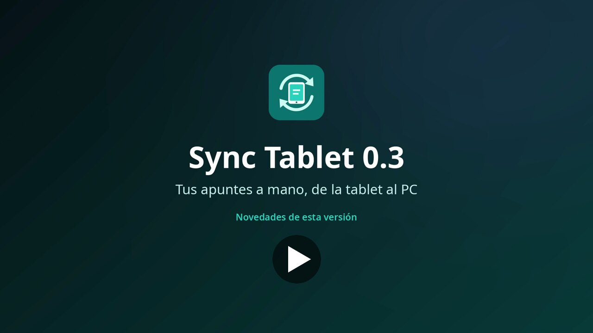
  </a><br />
  <sub>▶ Video de 44 segundos con las novedades de la 0.3</sub>
</p>

## Novedades de la 0.3

<table>
  <tr>
    <td width="50%">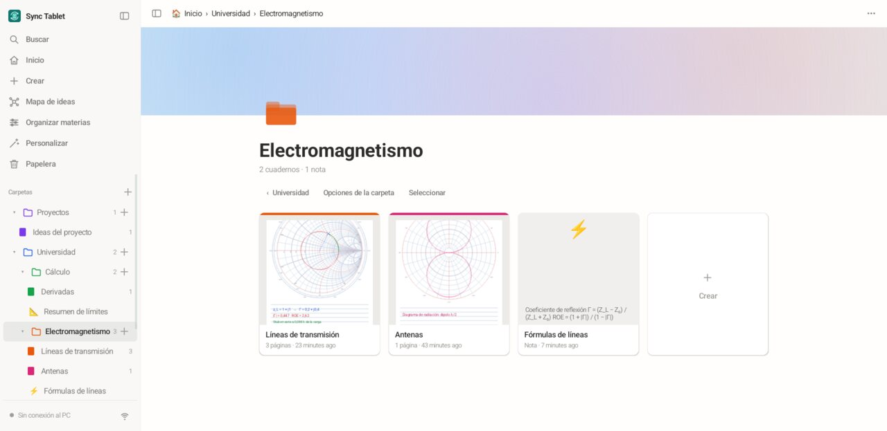<br /><b>Carpetas dentro de carpetas</b>, con colores. Cuadernos, notas, documentos y diagramas conviven en la misma carpeta.</td>
    <td width="50%">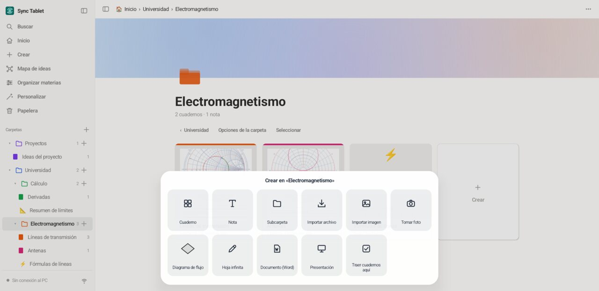<br /><b>Un solo «Crear»</b>: cuaderno, nota, carpeta, importar archivo o imagen, tomar foto, diagrama, hoja infinita, documento, hoja de cálculo o presentación.</td>
  </tr>
  <tr>
    <td>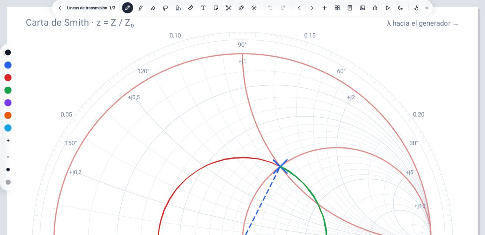<br /><b>Hojas para ingeniería</b>: Carta de Smith, semilogarítmica, logarítmica (log-log) y polar.</td>
    <td>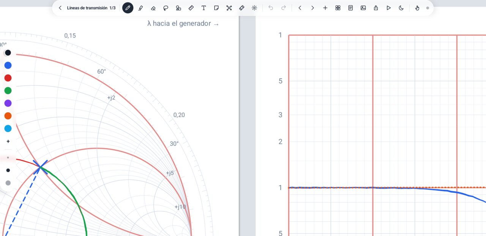<br /><b>Páginas a la derecha</b>, además de hacia abajo, para comparar hojas lado a lado.</td>
  </tr>
  <tr>
    <td>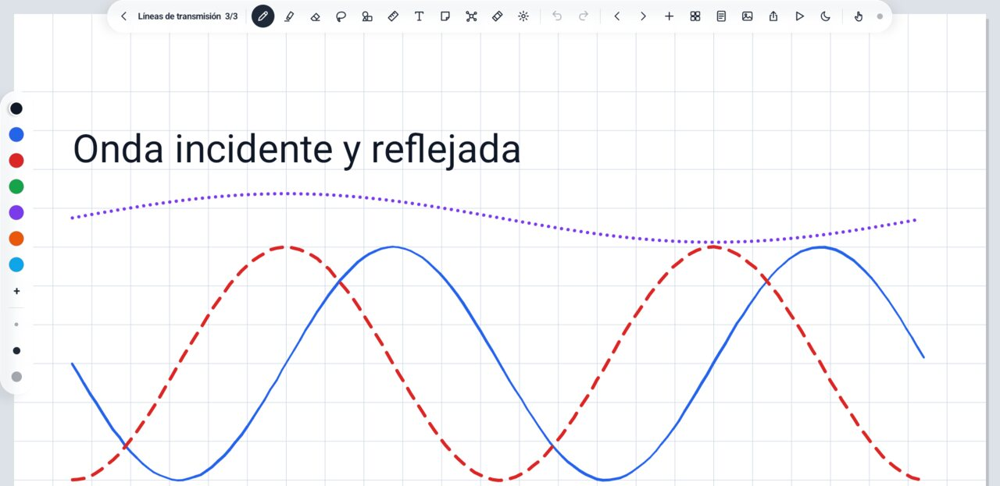<br /><b>Lápiz punteado y rayado</b>, también en el PDF, en el PC y en el visor web.</td>
    <td>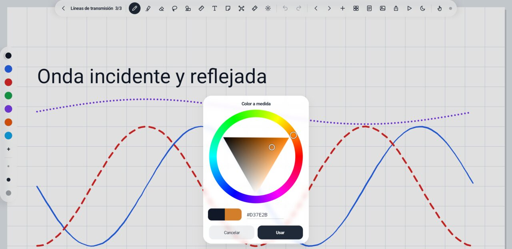<br /><b>Colores como en Krita</b>: anillo de tonos con triángulo, código <code>#RRGGBB</code> y recientes.</td>
  </tr>
  <tr>
    <td>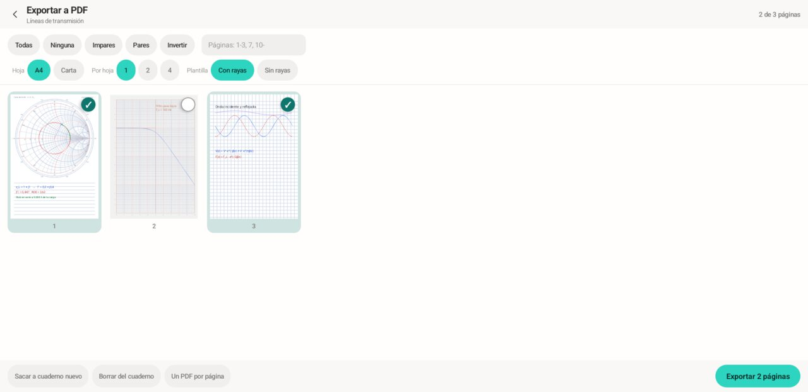<br /><b>Exportar a PDF eligiendo páginas</b>: todas, pares, impares o «1-3, 7»; 1, 2 o 4 por hoja; varios cuadernos en un PDF; sacar páginas a otro cuaderno.</td>
    <td>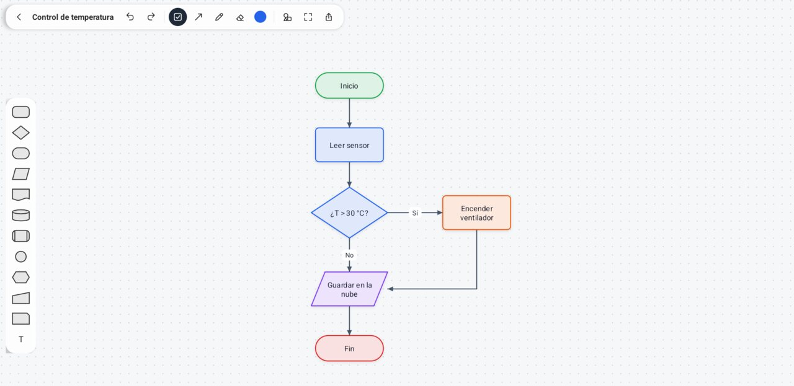<br /><b>Diagramas de flujo</b> en una hoja infinita: flechas «+» que crean el paso siguiente ya conectado, conectores que siguen a las figuras y exportar a PDF o PNG.</td>
  </tr>
  <tr>
    <td>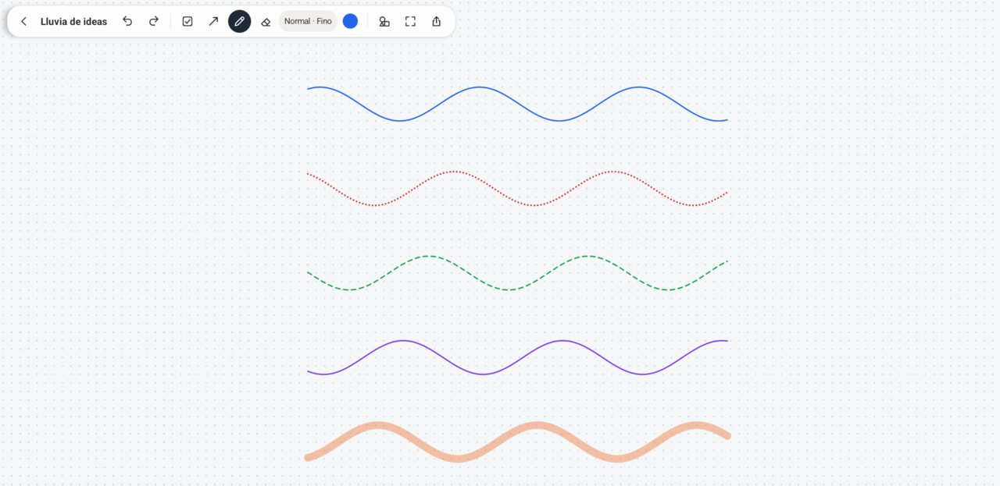<br /><b>Hoja infinita</b> para escribir sin bordes: normal, punteado, rayado o resaltador.</td>
    <td>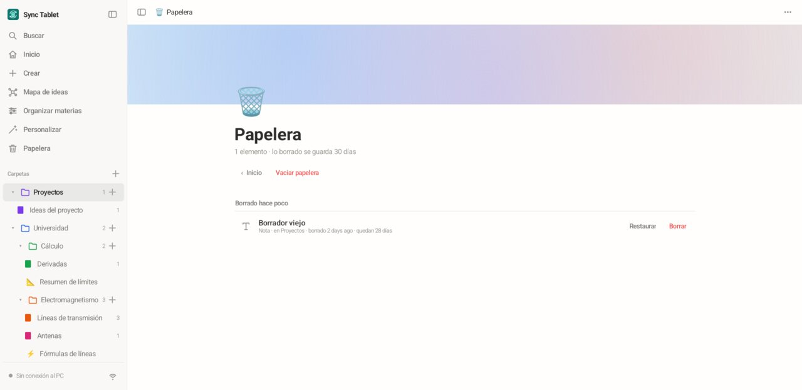<br /><b>Papelera</b>: lo borrado se guarda 30 días y se puede restaurar.</td>
  </tr>
</table>

## Qué hace

- **En la tablet:** cuadernos y páginas (A4). El **lápiz escribe** (con presión) y
  **el dedo mueve la hoja y hace zoom**, así la palma no pinta. Funciona sin el PC.
- **Herramientas como en Samsung Notes:** pluma, lápiz, pincel, caligrafía, marcador,
  estilográfica, punteado y rayado; resaltador; goma de trazo o parcial; **lazo**
  (mover, cambiar tamaño, recolorear, duplicar, borrar); texto; cinta para tapar
  respuestas; puntero láser (también se ve en el PC); lápices propios con nombre.
- **Figuras perfectas y circuitos:** deja el lápiz quieto medio segundo y el trazo se
  convierte en línea, círculo, rectángulo o triángulo; también resistencias,
  transistores, amplificadores operacionales y compuertas lógicas.
- **22 hojas:** rayas, cuadros, puntos, Cornell, milimetrada, ingeniería, isométrica,
  hexagonal, Carta de Smith, logarítmicas, polar, pentagrama, semana, storyboard…
- **PDF, Word, PowerPoint y fotos:** importa un PDF y escribe encima; exporta a PDF
  (eligiendo páginas), imagen, Markdown o PowerPoint.
- **En el PC:** lo que escribes aparece al momento en `http://localhost:8788`, y cada
  página se guarda en `~/SyncTablet/<Cuaderno>/Página NN.svg`.
- **Notas de bloques** en la tablet y en el PC (títulos, listas, tareas, llamadas y
  páginas a mano dentro), sincronizadas y guardadas también como `.md`.
- **Sin conexión:** la tablet guarda todo y, al volver a conectar, el PC se pone al día.

<details>
<summary><b>Más: hojas de cálculo, presentaciones, documentos y otras herramientas</b></summary>

- **Hojas de cálculo:** con el motor de [GridCraft](https://github.com/storytold/gridcraft):
  sus funciones en español o inglés (`=SUMA`, `=SI`, `=BUSCARV`…), formato, filtros,
  varias hojas, gráficas, `.xlsx`/`.csv`/`.ods`, plantillas y análisis de datos.
- **Presentaciones al estilo Canva:** diez estilos, fotos, figuras, stickers y dibujo
  a mano; presentar a pantalla completa y exportar a PowerPoint o PDF.
- **Documentos como en Word:** hoja A4 con formato, listas, tablas e imágenes;
  importa y exporta `.docx` (WordCraft) y PDF.
- **Más:** regla, escuadras, transportador y compás; stickers; visor 3D (STL y OBJ);
  importar Xournal++ (`.xopp`); mapa de ideas; copia en Google Drive; escribir desde
  el PC.

</details>

## Cómo se usa

1. En el PC: `./synctablet` (deja la ventana abierta).
2. En la tablet: instala `synctablet.apk` y conecta el cable USB con la
   *depuración USB* activada (como en [Encaje](https://github.com/sthifen/encaje)).
   Por WiFi: en la app, botón **WiFi**, con la IP del PC y, si la tablet nunca se conectó por cable, el código que sale en el visor (**Conectar por WiFi**).
3. Escribe. Abre `http://localhost:8788` en el PC para verlo en vivo.

## Compilar

```bash
cargo build --release          # PC: target/release/synctablet
android/build-apk.sh --install # tablet: sin Gradle ni Android Studio
cargo test
tests/shapes.sh                # reconocedor de figuras, 60 rondas
```

## Cómo funciona

```
Tablet (Java, sin dependencias)                PC (Rust, axum)
InkView ── trazo/borrado ──► WebSocket ──USB (adb reverse) / WiFi──► /ws/ink ──► ~/SyncTablet (JSON + SVG)
                                                                          └──► /ws/live ──► visor web
```

- La tablet es la dueña de los datos: cada cambio sube la versión de la página. Al
  conectar manda la versión de cada página y el PC pide las que tiene atrasadas.
- `src/ink.rs` (modelo y operaciones), `src/store.rs` (disco), `src/svg.rs`
  (exportar), `src/notes.rs` (notas del PC y su `.md`), `src/server.rs`
  (HTTP/WebSocket), `src/adb.rs` (`adb reverse`).
- `web/index.html`: el visor, un solo archivo (HTML, CSS y JavaScript sin
  frameworks) incluido en el binario; la fuente Inter (`web/fonts/`) también.
- `android/src/dev/synctablet/`: `InkView` (dibujo de baja latencia), `Store`
  (guardado local), `SyncClient` (conexión), `MainActivity` (portada con barra lateral) + `Notes` + `BlockEditor`
  (notas de bloques; se sincronizan por HTTP con `/api/notes`, avisadas por `/ws/ink`).

## Próximas piezas

1. Enlaces entre notas; PDFs y fotos dentro de las notas.
2. Phone Link: notificaciones, fotos y archivos de la tablet en el PC.

## Licencia

Sync Tablet se distribuye bajo la licencia [MIT](LICENSE). Los componentes de terceros
y sus licencias están en [THIRD-PARTY-NOTICES.md](THIRD-PARTY-NOTICES.md).
