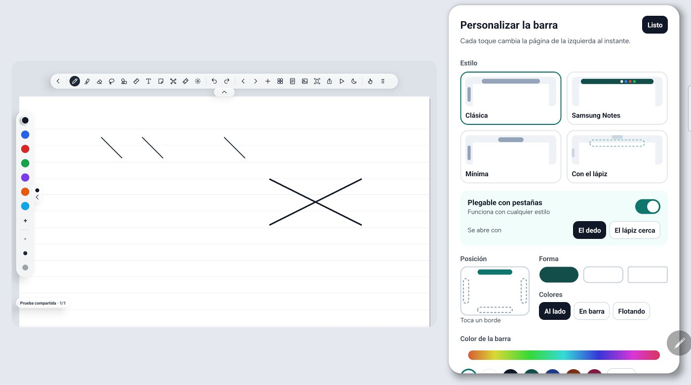
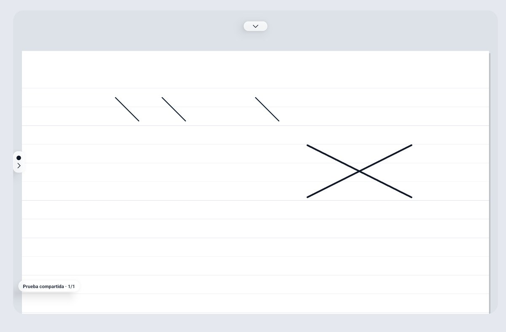
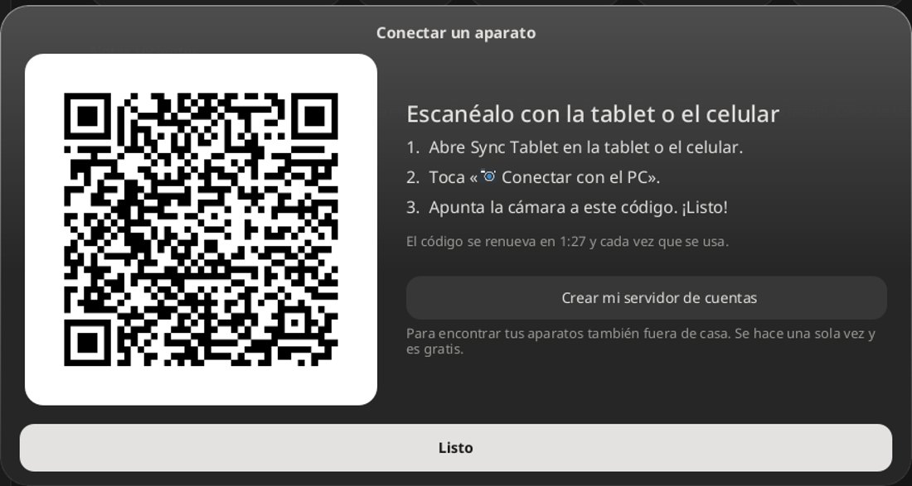
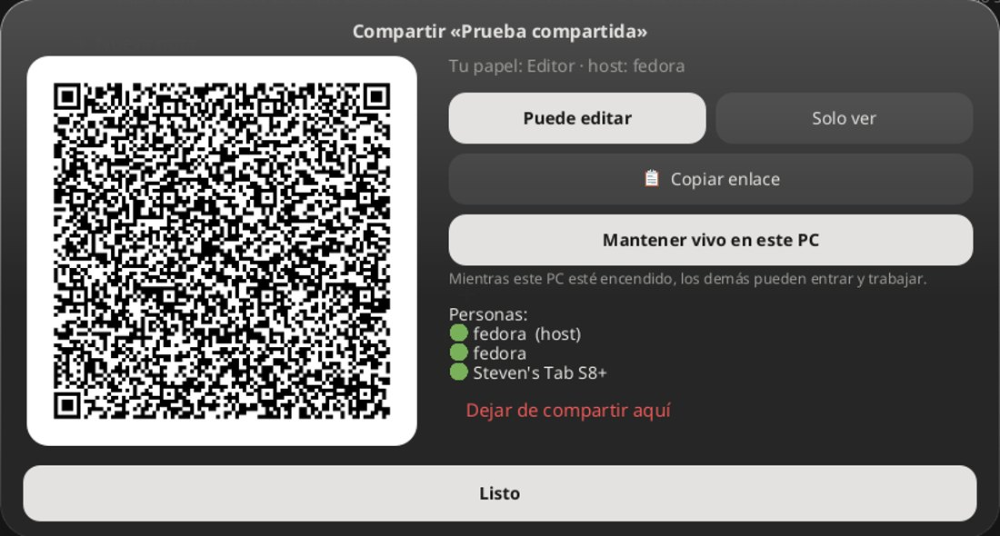

<p align="center">
  
</p>

<h1 align="center">Sync Tablet</h1>

<p align="center">
  <strong>Apuntes a mano en tu tablet Android que aparecen en vivo en tu PC con Linux,<br />y cuadernos compartidos con otras personas sin servidores de nadie.</strong><br />
  Handwritten notes on your Android tablet, live on your Linux PC — and shared notebooks with no one else's servers.
</p>

<p align="center">
  <a href="../../releases/latest"></a>
  
  
  <a href="LICENSE"></a>
</p>

<p align="center">
  <a href="../../releases/latest"><strong>⬇ Descargar</strong></a> ·
  <a href="#qué-hace">Qué hace</a> ·
  <a href="#cómo-se-usa">Cómo se usa</a> ·
  <a href="#cuadernos-compartidos">Compartir</a> ·
  <a href="#compilar">Compilar</a>
</p>

<p align="center">
  <a href="https://github.com/sthifen/sync-tablet/releases/download/v0.3.0/synctablet-0.3.mp4">
    
  </a><br />
  <sub>▶ Video de 44 segundos con las novedades de la 0.3</sub>
</p>

## Novedades de la 0.4

<table>
  <tr>
    <td width="50%"><br /><b>La barra, a tu gusto y en vivo.</b> Tu cuaderno se encoge a la izquierda y cada cambio se ve al instante: estilo, posición (arriba, abajo o a un lado), forma, color con espectro, tamaño y qué botones se ven (los demás quedan en «⋯»).</td>
    <td width="50%"><br /><b>Pestañas plegables</b> para cualquier estilo: la barra y los colores se esconden en una pestaña y bajan con una animación suave al tocarla con el dedo o al acercar el S Pen.</td>
  </tr>
  <tr>
    <td><br /><b>Conectar con un QR.</b> Nada de IPs: el PC enseña un QR que cambia solo y la tablet o el celular lo escanean con la cámara de la app.</td>
    <td><br /><b>Cuadernos compartidos en vivo</b>, estilo Hamachi: varias personas escriben a la vez; el host lo mantiene vivo y, si se apaga, sigue otro.</td>
  </tr>
</table>

- **App del PC en un solo AppImage** que lleva el servidor dentro: se abre y la tablet ya se conecta.
- **Mucho más fluida en el PC:** dibuja en memoria y repinta sólo lo que cambia (de ~12 a ~70 fotogramas por segundo).
- **Dedo quieto sobre la hoja:** pegar, cuadro de texto, nota adhesiva, ver el portapapeles, foto o plantilla.
- **Llave `{ }` y corchete `[ ]`** en las figuras, y **«ver la página entera»** con un botón.
- **El nombre del cuaderno** pasa a una etiqueta pequeña abajo y ya no empuja los botones.
- **Formato por defecto** de los cuadernos nuevos (rayas, cuadros, puntos…) en Personalizar.
- **Colores flotantes:** una burbuja que arrastras a donde estorbe menos.

<details>
<summary><b>Novedades de la 0.3</b></summary>

<table>
  <tr>
    <td width="50%"><br /><b>Carpetas dentro de carpetas</b>, con colores. Cuadernos, notas, documentos y diagramas conviven en la misma carpeta.</td>
    <td width="50%"><br /><b>Un solo «Crear»</b>: cuaderno, nota, carpeta, importar archivo o imagen, tomar foto, diagrama, hoja infinita, documento, hoja de cálculo o presentación.</td>
  </tr>
  <tr>
    <td><br /><b>Hojas para ingeniería</b>: Carta de Smith, semilogarítmica, logarítmica (log-log) y polar.</td>
    <td><br /><b>Páginas a la derecha</b>, además de hacia abajo, para comparar hojas lado a lado.</td>
  </tr>
  <tr>
    <td><br /><b>Lápiz punteado y rayado</b>, también en el PDF, en el PC y en el visor web.</td>
    <td><br /><b>Colores como en Krita</b>: anillo de tonos con triángulo, código <code>#RRGGBB</code> y recientes.</td>
  </tr>
  <tr>
    <td><br /><b>Exportar a PDF eligiendo páginas</b>: todas, pares, impares o «1-3, 7»; 1, 2 o 4 por hoja; varios cuadernos en un PDF; sacar páginas a otro cuaderno.</td>
    <td><br /><b>Diagramas de flujo</b> en una hoja infinita: flechas «+» que crean el paso siguiente ya conectado, conectores que siguen a las figuras y exportar a PDF o PNG.</td>
  </tr>
  <tr>
    <td><br /><b>Hoja infinita</b> para escribir sin bordes: normal, punteado, rayado o resaltador.</td>
    <td><br /><b>Papelera</b>: lo borrado se guarda 30 días y se puede restaurar.</td>
  </tr>
</table>

</details>

## Qué hace

- **En la tablet:** cuadernos y páginas (A4). El **lápiz escribe** (con presión) y
  **el dedo mueve la hoja y hace zoom**, así la palma no pinta. Funciona sin el PC.
- **Herramientas como en Samsung Notes:** pluma, lápiz, pincel, caligrafía, marcador,
  estilográfica, punteado y rayado; resaltador; goma de trazo o parcial; **lazo**
  (mover, cambiar tamaño, recolorear, duplicar, borrar); texto; cinta para tapar
  respuestas; puntero láser (también se ve en el PC); lápices propios con nombre.
- **Una barra que es tuya:** cuatro estilos de partida (Clásica, Samsung Notes, Mínima,
  Con el lápiz), plegable con pestañas, en cualquier borde, con los colores al lado,
  dentro de la barra o flotando, del color y la forma que quieras.
- **Figuras perfectas y circuitos:** deja el lápiz quieto medio segundo y el trazo se
  convierte en línea, círculo, rectángulo o triángulo; también llaves, corchetes,
  resistencias, transistores, amplificadores operacionales y compuertas lógicas.
- **22 hojas:** rayas, cuadros, puntos, Cornell, milimetrada, ingeniería, isométrica,
  hexagonal, Carta de Smith, logarítmicas, polar, pentagrama, semana, storyboard…
- **PDF, Word, PowerPoint y fotos:** importa un PDF y escribe encima; exporta a PDF
  (eligiendo páginas), imagen, Markdown o PowerPoint.
- **En el PC:** la misma app en una ventana de Linux, y cada página guardada también
  como `~/SyncTablet/<Cuaderno>/Página NN.svg`.
- **Cuadernos compartidos** con otras personas, en vivo y sin servidores de nadie
  ([abajo](#cuadernos-compartidos)).
- **Notas de bloques** en la tablet y en el PC (títulos, listas, tareas, llamadas y
  páginas a mano dentro), sincronizadas y guardadas también como `.md`.
- **Portapapeles compartido:** lo que copias en el PC se pega en la tablet y al revés.
- **Sin conexión:** la tablet guarda todo y, al volver a conectar, el PC se pone al día.

<details>
<summary><b>Más: hojas de cálculo, presentaciones, documentos y otras herramientas</b></summary>

- **Hojas de cálculo:** con el motor de [GridCraft](https://github.com/storytold/gridcraft):
  sus funciones en español o inglés (`=SUMA`, `=SI`, `=BUSCARV`…), formato, filtros,
  varias hojas, gráficas, `.xlsx`/`.csv`/`.ods`, plantillas y análisis de datos.
- **Presentaciones al estilo Canva:** diez estilos, fotos, figuras, stickers y dibujo
  a mano; presentar a pantalla completa y exportar a PowerPoint o PDF.
- **Documentos como en Word:** hoja A4 con formato, listas, tablas e imágenes;
  importa y exporta `.docx` (WordCraft) y PDF.
- **Más:** regla, escuadras, transportador y compás; stickers; visor 3D (STL y OBJ);
  importar Xournal++ (`.xopp`); mapa de ideas; copia en Google Drive; escribir desde
  el PC.

</details>

## Cómo se usa

1. **En el PC:** descarga `synctablet-escritorio-…-x86_64.AppImage` del
   [último release](../../releases/latest), dale permiso de ejecución y ábrela. Lleva
   el servidor dentro: no hay que abrir nada más.
2. **En la tablet o el celular:** instala `synctablet-….apk`.
3. **Conéctalos:**
   - **Por cable:** con la *depuración USB* activada, se conecta solo.
   - **Por WiFi:** en el PC pulsa **«📱 Conectar un aparato»**; en la tablet,
     **«📷 Conectar con el PC» → «Escanear QR del PC»**, y apunta la cámara. El QR
     cambia cada 2 minutos y cada vez que se usa.
4. Escribe: aparece en el PC al momento.

Las dos apps se actualizan solas desde **«Buscar actualización»**.

## Cuadernos compartidos

Como Hamachi, pero sin instalar nada más: **cada PC y cada tablet guardan una copia
completa** de los cuadernos que se compartieron con ellos y se hablan directamente.

- **Compartir:** mantén pulsado un cuaderno (clic derecho en el PC) →
  **«Compartir en vivo»**. Sale un QR y un enlace, **«Puede editar»** o **«Solo ver»**.
- **Entrar:** **Crear → «Unirse a un compartido»**: escanea el QR o pega el enlace. El
  cuaderno llega a la carpeta **Compartidos**.
- **Mantener vivo:** ese aparato hace de host mientras esté encendido. Si se apaga,
  sigue cualquier otro que lo tenga activado, y al volver se pone al día solo. En la
  tablet sigue funcionando con la app cerrada (con un aviso en la barra).
- **Seguro:** cada cambio va firmado (ECDSA P-256) con la clave de editor, que sólo
  llevan los enlaces de editor; para entrar hay que demostrar que se conoce el secreto
  del enlace sin enviarlo. Lo que dibuja un lector se queda en su aparato.

**Por internet:** el host le pide a su router que abra el puerto (UPnP), sin que
tengas que configurar nada. Funciona con la mayoría de routers de casa; no con redes
de universidad o empresa, datos móviles ni proveedores con CGNAT. Desde esas redes sí
puedes **entrar** a un cuaderno, pero no **hacer de host** para gente de fuera. En la
misma WiFi funciona siempre.

## Compilar

```bash
cargo build --release              # servidor del PC: target/release/synctablet
desktop/build.sh --install         # la app en el escritorio Linux (lleva el servidor)
desktop/build-appimage.sh          # el AppImage (necesita appimagetool)
android/build-apk.sh --install     # tablet: sin Gradle ni Android Studio
android/build-apk.sh --prueba      # otra app aparte, para probar sin tocar tus apuntes
cargo test
tests/shapes.sh                    # reconocedor de figuras, 60 rondas
python3 tools/avisos.py            # regenerar THIRD-PARTY-NOTICES.md
```

## Cómo funciona

```
Tablet / celular (Java)                         PC (Rust, axum) dentro del AppImage
InkView ── trazo ──► WebSocket ──USB (adb reverse) / WiFi (QR)──► /ws/ink ──► ~/SyncTablet (JSON + SVG)
                                                                     │
                       cuadernos compartidos: nodo ⇄ nodo (TCP 8790, operaciones firmadas)
                       ◄──────────────── otros PCs y tablets, en la WiFi o por internet ────────────────►
```

- **Sincronización:** cada cambio sube la versión de la página. Al conectar, cada
  aparato manda la versión de cada página; el PC pide las atrasadas y le manda lo que
  cambiaron los demás. Los trazos se aplican por su id, así que escribir a la vez no
  pierde nada.
- **Compartidos:** `src/shared.rs` (nodo del PC) y `SharedNode.java` (nodo de la
  tablet) hablan el mismo protocolo: un registro de operaciones firmadas; al conectarse
  dos nodos se mandan lo que le falta al otro, y lo nuevo se reenvía por toda la red.
- **Conexión:** `src/auth.rs` (QR y token), `src/account.rs` y `tracker/` (cuentas
  opcionales en Cloudflare para encontrar tus aparatos fuera de casa).
- **App de escritorio:** el mismo código de Android sobre una capa que imita su API
  con Java2D/Swing (`desktop/`), con repintado parcial.
- **Tablet:** `InkView` (dibujo de baja latencia), `PageActivity` (la hoja y su barra),
  `BarDesigner` (Personalizar), `Store` (guardado local), `SyncClient` (conexión).

## Próximas piezas

1. Documentos de Word compartidos entre varias personas.
2. Enlaces entre notas; PDFs y fotos dentro de las notas.
3. Phone Link: notificaciones, fotos y archivos de la tablet en el PC.

## Licencia

Sync Tablet se distribuye bajo la licencia [MIT](LICENSE). Los componentes de terceros
y sus licencias están en [THIRD-PARTY-NOTICES.md](THIRD-PARTY-NOTICES.md).
